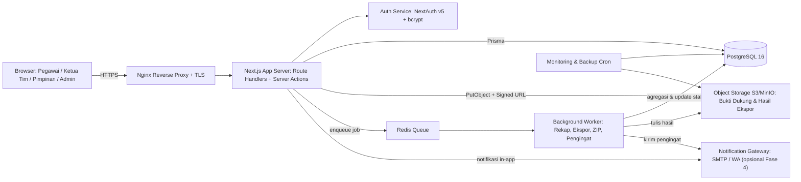

<!-- plankit project:a5aa6ed6-5571-4c32-a91b-079706ac92a9 | managed file: keep task ids, only edit the [ ] markers -->

# Dashboard Manajemen Pekerjaan Harian & Rekap SKP Pegawai BPS Kabupaten Kerinci

## 1. Ringkasan

Dashboard internal berbasis web untuk BPS Kabupaten Kerinci yang menggantikan alur kerja manual (Excel + WhatsApp + Google Drive) dalam mengalokasikan pekerjaan, mencatat capaian harian, dan mengumpulkan bukti dukung.

Alur intinya: **Ketua Tim mengalokasikan pekerjaan ke tiap anggota → Pegawai mencatat pekerjaan harinya + upload bukti dukung → Ketua Tim memverifikasi → Pimpinan memantau dashboard → akhir bulan sistem menarik rekap otomatis menjadi bahan penyusunan SKP bulanan per pegawai.**

Versi pertama harus bisa dipakai end-to-end oleh satu tim kerja dalam satu bulan penuh: alokasi → catat harian → upload bukti → verifikasi → ekspor rekap Excel.

Catatan: semua angka baseline operasional saat ini (mis. berapa lama rekap SKP dikerjakan, berapa jumlah pegawai) belum diberikan dan ditandai **[verify]** di dokumen ini. Jangan dikarang di implementasi maupun di materi sosialisasi.

## 2. Masalah & Peluang

**Masalah saat ini (asumsi dari deskripsi kebutuhan, perlu dikonfirmasi [verify]):**

- Alokasi pekerjaan dari ketua tim ke anggota tidak punya satu sumber kebenaran. Sebagian lisan, sebagian di grup WhatsApp, sebagian di file Excel terpisah per tim.
- Bukti dukung hasil pekerjaan tersebar (kamera HP, Google Drive, folder lokal, lampiran WhatsApp) dan tidak terhubung ke pekerjaan mana pun. Saat diaudit atau diminta pimpinan, pencariannya manual dan lambat.
- Pegawai sering mengisi catatan pekerjaan di akhir bulan secara backfill. Akibatnya detail hilang, dan rekap jadi tebakan.
- Pimpinan tidak punya visibilitas real-time: siapa mengerjakan apa, sudah sampai mana, mana yang mandek.
- Penyusunan SKP bulanan per pegawai adalah pekerjaan berulang yang makan waktu karena harus merangkum ulang dari banyak sumber dan mencocokkan bukti.

**Peluang:**

- Satu entri harian yang terstruktur (terhubung ke alokasi + bukti) otomatis menjadi agregat bulanan. Rekap SKP berubah dari "pekerjaan menyusun" menjadi "pekerjaan menekan tombol ekspor lalu menyesuaikan narasi".
- Ketua tim dapat membuktikan beban kerja anggota secara objektif (jumlah kegiatan, volume, hari terisi) dan menyeimbangkan alokasi bulan berikutnya.
- Jejak audit tersimpan: siapa menginput, kapan, siapa memverifikasi.

## 3. Target Pengguna & Persona

**Persona 1 — Pak R (Ketua Tim Kerja)**  
Titik nyeri: membagi tugas ke 4–8 anggota tiap awal bulan, lalu bolak-balik mengejar laporan dan bukti lewat WhatsApp.  
Yang dia butuh: form alokasi cepat (bisa copy dari bulan lalu), antrean verifikasi yang jelas, dan daftar siapa yang belum mengisi hari ini.

**Persona 2 — Yul (Pegawai / Anggota Tim)**  
Titik nyeri: lupa apa yang dikerjakan 3 minggu lalu; saat akhir bulan harus mengorek-orek chat dan galeri foto untuk membuktikan pekerjaan.  
Yang dia butuh: input harian yang cepat (< 2 menit per entri), upload bukti langsung dari HP, dan bisa lihat progres realisasi dirinya sendiri.

**Persona 3 — Bu K (Pimpinan / Kepala BPS Kabupaten Kerinci)**  
Titik nyeri: tidak bisa memantau beban kerja dan progres tanpa memanggil rapat atau meminta rekap manual.  
Yang dia butuh: satu layar ringkasan per tim dan per pegawai, plus drill-down kalau ada angka yang mencurigakan.

**Persona 4 — Admin Sistem (Pengelola IT/Operator)**  
Titik nyeri: mengelola akun, periode, dan hari libur.  
Yang dia butuh: CRUD sederhana, reset password, dan kemampuan mengunci periode.

## 4. Tujuan & Metrik Sukses

**Tujuan produk (6 bulan pertama):**

1. Semua tim kerja di BPS Kabupaten Kerinci mencatat pekerjaan harian di dashboard, bukan di Excel/WhatsApp.
2. Rekap SKP bulanan bisa dihasilkan dalam < 15 menit per pegawai (dari proses manual [verify]).
3. Setiap entri pekerjaan punya bukti dukung yang terhubung, bukan file lepas.

**Metrik sukses (terukur):**

| Metrik | Baseline | Target | Cara ukur |
|---|---|---|---|
| Pegawai aktif (login minimal 1x dalam seminggu) | 0% | ≥ 90% dari total pegawai [verify jumlahnya] | Query `AuditLog` login per minggu |
| Hari kerja terisi catatan (per pegawai per bulan) | — | ≥ 85% dari hari kerja efektif | `COUNT(DISTINCT tanggal) / hari_kerja_periode` |
| Entri yang diisi pada hari yang sama (bukan backfill H+1 ke atas) | — | ≥ 80% pada bulan ke-3 | `created_at::date = tanggal` |
| Entri dengan ≥ 1 bukti dukung | — | ≥ 95% | Join `BuktiDukung` |
| Waktu tunggu verifikasi ketua tim | — | median ≤ 2 hari kerja | `verified_at - submitted_at` |
| Waktu generate + ekspor rekap 1 pegawai | [verify] | ≤ 30 detik | Log worker |
| p95 waktu muat halaman dashboard | — | ≤ 2,0 detik | Metrik server/APM |
| Error rate API 5xx | — | < 1% per minggu | Log server |

## 5. Di Luar Cakupan

Supaya agent tidak over-build, hal-hal berikut **tidak dibangun** di versi ini:

- **Integrasi langsung ke sistem eksternal** (e-Kinerja BKN, SIKEP, SIMPEG, atau aplikasi pusat BPS). Ekspor ke Excel saja; impor/ekspor otomatis di luar cakupan.
- **Tanda tangan digital / sertifikat elektronik (BSrE)** untuk pengesahan SKP. Cukup kolom catatan dan status "disahkan" manual.
- **Aplikasi mobile native (Android/iOS).** Cukup web responsive/PWA.
- **Chat internal / kolom komentar berulir.** Komunikasi tetap di WhatsApp; dashboard hanya menampilkan catatan verifikasi.
- **Absensi, cuti, izin, dan presensi berbasis GPS/selfie.** Kalender hari kerja hanya untuk perhitungan, bukan mesin presensi.
- **Penilaian perilaku kerja** (orientasi pelayanan, integritas, komitmen, disiplin, kerja sama, kepemimpinan) beserta bobotnya.
- **Mesin workflow berlapis** (verifikasi berjenjang lebih dari 2 level). Hanya pegawai → ketua tim.
- **Notifikasi WhatsApp otomatis** di Fase 1–3. Fase 4 opsional, dan hanya kalau gateway tersedia.
- **SSO / LDAP / Google Workspace.** Login kredensial lokal dulu.
- **Multi-tenant / multi-instansi kabupaten lain.** Satu instansi, satu database.
- **Offline-first sync.** PWA boleh cache shell, tapi input butuh koneksi.

## 6. User Stories

- As a Ketua Tim, I want mengalokasikan pekerjaan bulanan ke beberapa anggota sekaligus dengan target volume, so that pembagian kerja jelas dan tidak tumpang tindih.
- As a Ketua Tim, I want menyalin alokasi bulan lalu sebagai template, so that saya tidak mengetik ulang rutinitas yang sama tiap bulan.
- As a Ketua Tim, I want melihat daftar anggota yang belum mengisi catatan hari ini, so that saya bisa mengingatkan sebelum hari berakhir.
- As a Ketua Tim, I want menyetujui atau meminta revisi entri beserta catatan, so that kualitas laporan terjaga dan bukti dukungnya benar.
- As a Pegawai, I want mencatat pekerjaan hari ini dalam < 2 menit dari HP, so that tidak ada alasan menunda sampai akhir bulan.
- As a Pegawai, I want mengunggah foto/PDF bukti dukung langsung dari kamera atau file, so that buktinya tidak hilang di galeri.
- As a Pegawai, I want melihat progres realisasi saya terhadap target alokasi, so that saya tahu apa yang masih kurang sebelum akhir bulan.
- As a Pegawai, I want melihat dan memperbaiki entri yang diminta revisi, so that saya bisa melengkapinya tanpa bertanya lewat chat.
- As a Pimpinan, I want melihat ringkasan progres seluruh pegawai dalam satu layar, so that saya bisa menilai beban kerja dan capaian tanpa memanggil rapat.
- As a Pimpinan, I want menelusuri detail harian seorang pegawai beserta buktinya, so that angka rekap bisa diverifikasi kalau dipertanyakan.
- As a Pimpinan, I want menarik rekap bulanan per pegawai ke Excel, so that jadi dasar penyusunan capaian kinerja bulanan.
- As an Admin, I want mengelola akun, tim, periode, dan hari libur, so that data acuan tetap benar sepanjang tahun.

## 7. Fitur & Kebutuhan Fungsional

### Autentikasi & Manajemen Pengguna

**Fase:** 1 · **Prioritas:** Must

Login lokal dengan NIP/email, kontrol akses berbasis peran (RBAC), dan pengelolaan akun oleh admin.

- [FR-1] The system shall mengautentikasi pengguna dengan NIP atau email + password, memakai hashing bcrypt (cost ≥ 12).
- [FR-2] The system shall menerapkan 4 peran — `PEGAWAI`, `KETUA_TIM`, `PIMPINAN`, `ADMIN` — dan menolak (HTTP 403) akses endpoint di luar perannya.
- [FR-3] The system shall menyediakan CRUD pengguna oleh `ADMIN`: buat, ubah profil, reset password (generate password sementara), dan nonaktifkan akun tanpa menghapus riwayat pekerjaannya.
- [FR-4] The system shall membatasi sesi dengan masa berlaku 8 jam dan idle timeout 60 menit, serta menyediakan tombol logout yang menghapus sesi.
- [FR-5] The system shall mengizinkan pengguna mengganti password sendiri dengan minimal 8 karakter, dan menolak password yang sama dengan 3 password terakhir.
- [FR-6] The system shall mencatat setiap perubahan peran, reset password, dan penonaktifan akun ke `AuditLog`.

### Master Data Organisasi & Periode Bulanan

**Fase:** 1 · **Prioritas:** Must

Fondasi data: tim kerja, keanggotaan, periode bulanan, dan kalender hari kerja.

- [FR-7] The system shall menyediakan CRUD `TimKerja` (nama, tahun, ketua) oleh `ADMIN`.
- [FR-8] The system shall mengizinkan `ADMIN`/`KETUA_TIM` menetapkan anggota tim per periode, dan menyimpan riwayat keanggotaan (seorang pegawai bisa pindah tim antar periode tanpa merusak data lama).
- [FR-9] The system shall menyediakan CRUD `Periode` (tahun + bulan unik) dengan status `DRAFT`, `AKTIF`, `DIKUNCI`; hanya satu periode boleh `AKTIF` pada satu waktu.
- [FR-10] The system shall menghitung otomatis hari kerja efektif sebagai Senin–Jumat dikurangi entri pada tabel `HariLibur`.
- [FR-11] The system shall mengizinkan `ADMIN` menambah/menghapus hari libur nasional dan cuti bersama per tanggal beserta keterangannya.
- [FR-12] The system shall menyediakan master `Kegiatan` opsional (kode, uraian, satuan) sebagai label yang bisa dipetakan ke uraian SKP.

### Alokasi Pekerjaan oleh Ketua Tim

**Fase:** 1 · **Prioritas:** Must

Ketua tim membagi pekerjaan ke anggota dengan target yang terukur.

- [FR-13] The system shall mengizinkan `KETUA_TIM` membuat alokasi dengan field wajib: judul, deskripsi, penerima, tanggal mulai, tanggal selesai, target volume, satuan, dan prioritas (`RENDAH`/`SEDANG`/`TINGGI`); satu alokasi hanya boleh berada dalam satu periode.
- [FR-14] The system shall mengizinkan satu alokasi ditugaskan ke lebih dari satu anggota dengan target volume per orang yang bisa berbeda.
- [FR-15] The system shall menolak pembuatan/perubahan alokasi pada periode berstatus `DIKUNCI`.
- [FR-16] The system shall menyediakan aksi "Salin dari periode sebelumnya" yang menyalin daftar alokasi (tanpa capaian dan bukti) ke periode berjalan untuk direview sebelum disimpan.
- [FR-17] The system shall menolak penghapusan alokasi yang sudah punya entri harian; sebagai gantinya alokasi diubah statusnya menjadi `DIBATALKAN` dan wajib disertai alasan.
- [FR-18] The system shall menampilkan progres realisasi tiap alokasi (`SUM(volume entri disetujui) / target volume`) dalam bentuk angka dan progress bar.

### Catatan Pekerjaan Harian Pegawai

**Fase:** 1 · **Prioritas:** Must

Jantung produk: entri harian yang cepat dan terikat pada alokasi.

- [FR-19] The system shall mengizinkan `PEGAWAI` membuat entri harian yang mewajibkan pemilihan alokasi miliknya, plus opsi entri "Tugas Tambahan/Ad-hoc" dengan flag `is_ad_hoc = true` dan deskripsi bebas.
- [FR-20] The system shall memvalidasi bahwa tanggal entri adalah hari kerja (bukan Sabtu/Minggu/hari libur) dan berada di dalam rentang periode `AKTIF`; input backfill dibatasi maksimal 3 hari kalender ke belakang dan ditandai `is_backfill = true`.
- [FR-21] The system shall menyimpan field: tanggal, alokasi, deskripsi capaian, volume, satuan, status (`BELUM_MULAI`/`PROSES`/`SELESAI`), dan kendala (opsional).
- [FR-22] The system shall menghitung ulang akumulasi volume dan persentase progres alokasi setiap kali entri dibuat, diubah, atau diverifikasi.
- [FR-23] The system shall mengizinkan `PEGAWAI` mengubah/menghapus entrinya sendiri hanya selama periode belum `DIKUNCI` dan status verifikasinya bukan `DISETUJUI`.
- [FR-24] The system shall menampilkan tampilan kalender bulanan yang menandai tiap hari kerja dengan status: tidak ada entri, ada entri belum diverifikasi, ada entri disetujui, atau ada yang perlu revisi.

### Bukti Dukung

**Fase:** 1 · **Prioritas:** Must

Setiap pekerjaan harus bisa dibuktikan dengan lampiran.

- [FR-25] The system shall mengizinkan upload 1–n file per entri harian dengan format `jpg`, `jpeg`, `png`, `pdf`, `docx`, `xlsx`, ukuran maksimum 10 MB per file, dan maksimum 10 file per entri.
- [FR-26] The system shall memvalidasi tipe file berdasarkan MIME type **dan** magic bytes (bukan hanya ekstensi), menghasilkan nama file unik (UUID) di object storage, dan menolak file yang tidak sesuai.
- [FR-27] The system shall menampilkan pratinjau inline untuk gambar dan PDF, serta ikon generik + tombol unduh untuk format lain.
- [FR-28] The system shall mengizinkan `PEGAWAI` menghapus atau mengganti bukti hanya sebelum entri berstatus `DISETUJUI`.
- [FR-29] The system shall menyajikan unduhan bukti melalui signed URL berumur ≤ 15 menit, bukan URL publik permanen.
- [FR-30] The system shall menampilkan indikator kelengkapan bukti (ikon + label "Ada bukti"/"Belum ada bukti") pada setiap baris entri dan pada daftar pekerjaan harian.

### Verifikasi & Umpan Balik Ketua Tim

**Fase:** 2 · **Prioritas:** Must

Menjaga kualitas data sebelum jadi rekap.

- [FR-31] The system shall menyediakan antrean "Menunggu Verifikasi" untuk `KETUA_TIM`, berisi entri anggota timnya saja, diurutkan dari yang paling lama menunggu.
- [FR-32] The system shall menyediakan aksi `SETUJUI`, `MINTA_REVISI`, dan `TOLAK`; aksi selain `SETUJUI` mewajibkan catatan minimal 10 karakter.
- [FR-33] The system shall menyediakan aksi bulk approve untuk entri terpilih, dengan konfirmasi jumlah dan daftar tanggal yang akan disetujui.
- [FR-34] The system shall membuat notifikasi in-app ke pegawai setiap kali status verifikasi entrinya berubah, memuat catatan verifikator.
- [FR-35] The system shall menyimpan riwayat verifikasi secara append-only (entri `Verifikasi` tidak boleh di-update atau di-delete), termasuk verifikator dan timestamp.
- [FR-36] The system shall mengizinkan `PIMPINAN` melihat status verifikasi agregat per pegawai tanpa hak untuk mengubahnya.

### Dashboard Monitoring Pimpinan

**Fase:** 2 · **Prioritas:** Should

Satu layar untuk melihat kesehatan pelaksanaan pekerjaan bulan berjalan.

- [FR-37] The system shall menampilkan kartu ringkasan: jumlah pegawai aktif, jumlah alokasi periode ini, entri terisi hari ini, entri menunggu verifikasi, dan persentase entri yang punya bukti.
- [FR-38] The system shall menampilkan tabel per pegawai berisi: jumlah entri, total volume per satuan, persentase hari kerja terisi, jumlah entri belum diverifikasi, dan status terakhir verifikasi.
- [FR-39] The system shall menyediakan drill-down dari baris pegawai ke daftar entri harian pegawai tersebut pada periode terpilih, lengkap dengan pratinjau bukti.
- [FR-40] The system shall menyediakan filter periode, tim kerja, dan pegawai, dengan default periode `AKTIF` dan tim milik pengguna.
- [FR-41] The system shall menyediakan ekspor snapshot tabel dashboard ke XLSX sesuai filter yang aktif.
- [FR-42] The system shall menampilkan ikon lonceng notifikasi in-app dengan jumlah belum dibaca dan daftar notifikasi terbaru.

### Rekap Bulanan & Ekspor SKP

**Fase:** 3 · **Prioritas:** Must

Ujung dari semua input: bahan SKP bulanan per pegawai.

- [FR-43] The system shall men-*generate* rekap per pegawai per periode dari agregasi alokasi, entri harian, capaian volume, status verifikasi, dan jumlah bukti dukung; proses berjalan asinkron dan statusnya bisa dipantau.
- [FR-44] The system shall mengekspor rekap ke XLSX multi-sheet: satu sheet ringkasan semua pegawai, plus satu sheet detail per pegawai (baris = alokasi, kolom = target, realisasi, satuan, % capaian, jumlah bukti, tanggal-tanggal pelaksanaan).
- [FR-45] The system shall mengekspor rekap per pegawai ke PDF dengan header instansi, periode, identitas pegawai, dan tabel capaian yang siap dicetak.
- [FR-46] The system shall menyediakan aksi "Kunci Periode" oleh `ADMIN`/`PIMPINAN` yang membuat seluruh entri periode tersebut read-only dan memicu generate rekap final otomatis.
- [FR-47] The system shall menyimpan setiap hasil rekap sebagai arsip berversi (`versi` bertambah setiap generate ulang) beserta siapa dan kapan yang men-*generate*.
- [FR-48] The system shall menyediakan unduhan ZIP berisi seluruh file bukti dukung satu pegawai dalam satu periode, terstruktur per tanggal dan per alokasi, maksimum 500 MB per unduhan.

## 8. Alur Pengguna Utama

### Alur A — Ketua Tim mengalokasikan pekerjaan awal bulan

1. `KETUA_TIM` login. Sistem mendeteksi periode `AKTIF` dan menampilkan banner "Alokasi periode <Bulan> belum lengkap untuk 3 anggota".
2. Ketua tim membuka **Alokasi → Tambah**. Form muncul dengan pilihan tim dan daftar anggota timnya.
3. Ketua tim mengisi judul, deskripsi, target volume + satuan, rentang tanggal, prioritas, lalu memilih satu atau beberapa anggota (target per orang bisa diubah).
4. Opsional: menekan **Salin dari bulan lalu**, mencentang alokasi rutin, dan menyimpannya sebagai draft baru untuk direview.
5. Simpan. Sistem memvalidasi periode tidak `DIKUNCI` dan rentang tanggal berada dalam periode. Setelah sukses, tiap anggota mendapat notifikasi in-app.
6. Ketua tim melihat daftar alokasi dengan progress bar 0% dan dapat mengunduh daftar tersebut untuk ditempel di grup WhatsApp.

### Alur B — Pegawai mencatat pekerjaan harian + upload bukti

1. `PEGAWAI` login dari HP. Halaman **Hari Ini** langsung menampilkan daftar alokasi miliknya yang masih berjalan dan status pengisian hari ini.
2. Pegawai menekan **+ Catat Pekerjaan**, memilih alokasi dari dropdown (default: alokasi prioritas `TINGGI` yang paling dekat deadline).
3. Mengisi deskripsi capaian, volume (default dari sisa target), status, dan kendala bila ada.
4. Menekan **Lampirkan Bukti**, memilih kamera atau file. Sistem menampilkan progress upload, memvalidasi MIME + magic bytes, dan menampilkan thumbnail setelah selesai.
5. Simpan. Sistem menyimpan entri, menghitung ulang progres alokasi, dan menandai entri sebagai "Menunggu verifikasi".
6. Pegawai melihat kalender bulanan; hari ini berubah menjadi kuning (belum diverifikasi). Kalau ada entri "Minta revisi", muncul badge merah di halaman **Revisi**.
7. Untuk entri revisi: pegawai membuka entri, membaca catatan ketua tim, memperbaiki deskripsi/volume/menambah bukti, lalu menyimpan. Entri kembali ke status "Menunggu verifikasi".

### Alur C — Verifikasi ketua tim & rekap SKP akhir bulan

1. `KETUA_TIM` login, membuka **Verifikasi**. Antrean menampilkan entri anggota timnya yang menunggu, diurutkan dari yang paling lama.
2. Ketua tim membuka satu entri, memeriksa deskripsi, volume, dan bukti (pratinjau inline). Memilih **Setujui**, atau **Minta Revisi** + catatan.
3. Untuk entri yang jelas, ketua tim menggunakan bulk approve: centang beberapa baris → **Setujui terpilih** → konfirmasi.
4. Setiap perubahan status mengirim notifikasi in-app ke pegawai terkait.
5. Pada akhir bulan, `ADMIN`/`PIMPINAN` membuka **Rekap → Generate** untuk periode tersebut. Worker menghitung agregat per pegawai dan menampilkan status selesai dalam < 30 detik.
6. Pimpinan mengunduh XLSX/PDF, memeriksa sheet ringkasan, dan kalau ada angka janggal melakukan drill-down ke entri harian + buktinya.
7. Setelah rekap final disahkan, `ADMIN` menekan **Kunci Periode**. Seluruh entri periode menjadi read-only, rekap final tersimpan sebagai versi terakhir, dan ZIP bukti dukung bisa diunduh untuk arsip.

## 9. Kebutuhan Non-Fungsional

**Performa**

- p95 waktu muat halaman list dan dashboard ≤ 2,0 detik pada koneksi 4G, untuk beban 100 pegawai × 22 hari kerja × 3 entri ≈ 6.600 entri per bulan; dashboard ≥ 3 tahun data harus tetap ≤ 3 detik.
- Upload file 10 MB harus selesai ≤ 30 detik pada koneksi 5 Mbps, dengan progress bar dan resume-friendly retry.
- Ekspor XLSX 1 periode penuh (≤ 100 pegawai) selesai ≤ 60 detik dan dijalankan sebagai background job, bukan blocking request.

**Keamanan**

- Seluruh trafik lewat HTTPS/TLS 1.2+. Password bcrypt cost ≥ 12. Tidak ada password default yang aktif di produksi.
- Otorisasi dicek di server untuk **setiap** request; kepemilikan data diverifikasi (pegawai hanya bisa mengubah entri miliknya, ketua tim hanya entri anggota timnya).
- Rate limit login: 5 percobaan gagal per NIP per 15 menit, lalu lockout sementara 15 menit.
- Validasi upload berdasarkan MIME + magic bytes; file disimpan di luar web root dan hanya diakses lewat signed URL. Nama file di-*sanitize*.
- `AuditLog` bersifat append-only dan tidak bisa diubah/dihapus lewat UI.
- CSRF protection aktif untuk semua request yang mengubah state.

**Reliabilitas & Data**

- Backup PostgreSQL otomatis harian dengan retensi 30 hari, plus backup mingguan retensi 12 bulan. Restore harus pernah diuji minimal sekali sebelum go-live.
- Object storage backup/mirror harian untuk folder bukti dukung.
- Target ketersediaan 99% pada jam kerja (07.30–16.30 WIB).
- Semua timestamp disimpan UTC dan ditampilkan dalam zona `Asia/Jakarta` (WIB).

**Usabilitas**

- Bahasa Indonesia sepenuhnya di seluruh UI, pesan error, dan email/notifikasi.
- Responsive minimal lebar 360 px; tombol aksi utama berukuran ≥ 44×44 px agar nyaman disentuh.
- Form entri harian harus bisa diselesaikan dalam ≤ 2 menit oleh pengguna baru tanpa pelatihan.
- Kontras warna memenuhi WCAG 2.1 level AA untuk teks utama.
- PWA: bisa di-*install* ke home screen Android dan menampilkan shell walau offline (input tetap butuh koneksi).

**Kompatibilitas & Pemeliharaan**

- Browser didukung: Chrome/Edge 2 versi terakhir, Safari iOS 2 versi terakhir.
- Log terstruktur (JSON) dengan request ID; error 5xx otomatis terkirim ke kanal pemantauan.
- Migrasi database bersifat versioned dan bisa di-rollback.
- Retensi data: entri pekerjaan dan bukti dukung disimpan minimal 5 tahun [verify terhadap aturan kearsipan BPS].

## 10. Arsitektur Sistem

**Komponen:**

1. **Web Client (Next.js App Router, React + TypeScript + Tailwind CSS)** — SPA-ish dengan SSR untuk halaman list/dashboard; PWA manifest + service worker untuk cache shell dan aset statis. Bertanggung jawab atas rendering, form, upload dengan progress, dan pratinjau bukti.
2. **API Layer (Next.js Route Handlers + Server Actions)** — Validasi input (Zod), otorisasi per peran, orkestrasi query Prisma, penerbitan signed URL, pencatatan `AuditLog`. Semua logika bisnis ada di sini, bukan di client.
3. **Auth Service (Auth.js/NextAuth v5, Credentials Provider)** — Sesi JWT di cookie HttpOnly + Secure + SameSite=Lax, hashing bcrypt, rate limiting login.
4. **PostgreSQL 16** — Datastore utama untuk pengguna, tim, periode, alokasi, entri harian, verifikasi, rekap, audit log, dan metadata bukti dukung.
5. **Object Storage (S3-compatible: MinIO self-hosted atau Supabase Storage/IDCloudHost Object Storage)** — Menyimpan file bukti dukung. Tidak pernah diakses langsung oleh browser tanpa signed URL.
6. **Background Worker (BullMQ + Redis, atau `pg-boss` bila ingin satu dependensi lebih sedikit)** — Menjalankan job asinkron: generate rekap bulanan, ekspor XLSX/PDF, pembuatan ZIP bukti dukung, pengiriman notifikasi, dan cron pengingat harian.
7. **Notification Gateway** — Email via SMTP instansi; Fase 4 opsional: WhatsApp Business API / gateway pihak ketiga. Kegagalan gateway tidak boleh menggagalkan transaksi utama (dikirim sebagai job dengan retry).
8. **Nginx Reverse Proxy + Docker Compose** — Terminasi TLS, proxy ke Next.js, batas ukuran body 12 MB, dan penyajian file statis.
9. **Monitoring** — Health check `/api/health`, log JSON ke file yang di-*rotate*, backup terjadwal via cron.

**Alur data:**

- Browser → Nginx (HTTPS) → Next.js API → Prisma → PostgreSQL untuk operasi baca/tulis data.
- Upload bukti: browser mengirim multipart ke Next.js API → API memvalidasi MIME/magic bytes → API menulis ke Object Storage → API menyimpan metadata (`BuktiDukung`) di PostgreSQL → API mengembalikan ID bukti (bukan URL publik).
- Unduh bukti: browser meminta `/api/bukti/:id/download` → API memeriksa otorisasi → API membuat signed URL berumur 15 menit → browser di-*redirect* ke object storage.
- Generate rekap: API membuat job di Redis → Worker mengambil data dari PostgreSQL → Worker menulis file hasil ke Object Storage → Worker memperbarui status `RekapSKP` di PostgreSQL → UI melakukan polling status → pengguna mengunduh lewat signed URL.
- Cron harian (07.00 WIB): Worker mengecek pegawai tanpa entri hari sebelumnya dan mengirim notifikasi in-app (Fase 2) atau email (Fase 4).

## 11. Model Data

### User

| field | type | notes |
|---|---|---|
| id | uuid (PK) | |
| nip | varchar(18) unique | NIP pegawai, dipakai untuk login |
| nama | varchar(120) | |
| email | varchar(160) unique nullable | opsional, untuk notifikasi |
| password_hash | varchar(255) | bcrypt cost ≥ 12 |
| role | enum | `PEGAWAI` \| `KETUA_TIM` \| `PIMPINAN` \| `ADMIN` |
| jabatan | varchar(120) nullable | |
| is_active | boolean | default true; nonaktif ≠ hapus |
| last_login_at | timestamptz nullable | |
| created_at / updated_at | timestamptz | |

### TimKerja

| field | type | notes |
|---|---|---|
| id | uuid (PK) | |
| nama | varchar(120) | contoh: "Tim Statistik Produksi" |
| tahun | int | tahun berjalan |
| ketua_id | uuid (FK → User) | harus berperan `KETUA_TIM` |
| is_active | boolean | |
| created_at / updated_at | timestamptz | |

### AnggotaTim

| field | type | notes |
|---|---|---|
| id | uuid (PK) | |
| tim_id | uuid (FK → TimKerja) | |
| user_id | uuid (FK → User) | |
| periode_id | uuid (FK → Periode) | riwayat keanggotaan per periode |
| peran_dalam_tim | enum | `KETUA` \| `ANGGOTA` |
| created_at | timestamptz | |

### Periode

| field | type | notes |
|---|---|---|
| id | uuid (PK) | |
| tahun | int | |
| bulan | int (1–12) | unik bersama `tahun` |
| tanggal_mulai | date | |
| tanggal_selesai | date | |
| jumlah_hari_kerja | int | dihitung dari kalender hari libur |
| status | enum | `DRAFT` \| `AKTIF` \| `DIKUNCI` |
| dikunci_oleh / dikunci_at | uuid / timestamptz nullable | |
| created_at / updated_at | timestamptz | |

### HariLibur

| field | type | notes |
|---|---|---|
| id | uuid (PK) | |
| tanggal | date unique | |
| keterangan | varchar(160) | contoh: "Cuti Bersama Idul Fitri" |
| jenis | enum | `LIBUR_NASIONAL` \| `CUTI_BERSAMA` \| `LIBUR_LAIN` |

### Kegiatan

| field | type | notes |
|---|---|---|
| id | uuid (PK) | |
| kode | varchar(40) unique | opsional, kode internal |
| uraian | text | uraian kegiatan yang bisa dipetakan ke SKP |
| satuan_default | varchar(30) nullable | |
| is_active | boolean | |

### Alokasi

| field | type | notes |
|---|---|---|
| id | uuid (PK) | |
| periode_id | uuid (FK → Periode) | |
| tim_id | uuid (FK → TimKerja) | |
| kegiatan_id | uuid (FK → Kegiatan) nullable | label opsional |
| judul | varchar(200) | |
| deskripsi | text | |
| tanggal_mulai / tanggal_selesai | date | harus dalam rentang periode |
| target_volume | numeric(12,2) | target per penerima |
| satuan | varchar(30) | contoh: "dokumen", "desa", "laporan" |
| prioritas | enum | `RENDAH` \| `SEDANG` \| `TINGGI` |
| status | enum | `AKTIF` \| `SELESAI` \| `DIBATALKAN` |
| alasan_pembatalan | text nullable | wajib jika status `DIBATALKAN` |
| dibuat_oleh | uuid (FK → User) | |
| created_at / updated_at | timestamptz | |

### PenugasanAlokasi

| field | type | notes |
|---|---|---|
| id | uuid (PK) | |
| alokasi_id | uuid (FK → Alokasi) | |
| user_id | uuid (FK → User) | penerima tugas |
| target_volume | numeric(12,2) | bisa berbeda per orang |
| created_at | timestamptz | |

### PekerjaanHarian

| field | type | notes |
|---|---|---|
| id | uuid (PK) | |
| periode_id | uuid (FK → Periode) | didenormalisasi untuk query cepat |
| penugasan_id | uuid (FK → PenugasanAlokasi) nullable | null jika `is_ad_hoc = true` |
| user_id | uuid (FK → User) | pencatat pekerjaan |
| tanggal | date | harus hari kerja |
| is_ad_hoc | boolean | default false |
| judul_ad_hoc | varchar(200) nullable | wajib jika `is_ad_hoc` |
| deskripsi_capaian | text | |
| volume | numeric(12,2) | default 1 |
| satuan | varchar(30) | |
| status | enum | `BELUM_MULAI` \| `PROSES` \| `SELESAI` |
| kendala | text nullable | |
| is_backfill | boolean | true jika `created_at::date > tanggal` |
| status_verifikasi | enum | `MENUNGGU` \| `DISETUJUI` \| `MINTA_REVISI` \| `DITOLAK` |
| created_at / updated_at | timestamptz | |

### BuktiDukung

| field | type | notes |
|---|---|---|
| id | uuid (PK) | |
| pekerjaan_harian_id | uuid (FK → PekerjaanHarian) | |
| nama_asli | varchar(255) | nama file dari pengguna (disanitize saat ditampilkan) |
| object_key | varchar(500) unique | path di object storage, format `periode/YYYY-MM/userId/uuid.ext` |
| mime_type | varchar(120) | hasil deteksi magic bytes |
| ukuran_bytes | bigint | maks 10 MB |
| checksum_sha256 | char(64) | deteksi duplikat & verifikasi integritas |
| uploaded_by | uuid (FK → User) | |
| uploaded_at | timestamptz | |

### Verifikasi

| field | type | notes |
|---|---|---|
| id | uuid (PK) | |
| pekerjaan_harian_id | uuid (FK → PekerjaanHarian) | |
| verifikator_id | uuid (FK → User) | harus `KETUA_TIM` dari tim terkait |
| aksi | enum | `SETUJUI` \| `MINTA_REVISI` \| `TOLAK` |
| catatan | text nullable | wajib ≥ 10 karakter untuk aksi selain `SETUJUI` |
| created_at | timestamptz | append-only |

### RekapSKP

| field | type | notes |
|---|---|---|
| id | uuid (PK) | |
| periode_id | uuid (FK → Periode) | |
| user_id | uuid (FK → User) | |
| versi | int | bertambah tiap generate ulang |
| status | enum | `QUEUED` \| `PROSES` \| `SELESAI` \| `GAGAL` |
| ringkasan_json | jsonb | agregat: total alokasi, total volume per satuan, % hari terisi, jumlah bukti |
| file_xlsx_key / file_pdf_key | varchar(500) nullable | path di object storage |
| error_message | text nullable | diisi jika `GAGAL` |
| digenerate_oleh | uuid (FK → User) | |
| created_at / finished_at | timestamptz | |

### Notifikasi

| field | type | notes |
|---|---|---|
| id | uuid (PK) | |
| user_id | uuid (FK → User) | penerima |
| tipe | enum | `ALOKASI_BARU` \| `VERIFIKASI` \| `REVISI` \| `PENGINGAT_HARIAN` \| `REKAP_SELESAI` |
| judul | varchar(200) | |
| isi | text | |
| link | varchar(300) nullable | deep link ke entitas terkait |
| is_read | boolean | default false |
| created_at | timestamptz | |

### AuditLog

| field | type | notes |
|---|---|---|
| id | bigserial (PK) | |
| user_id | uuid (FK → User) nullable | null untuk aksi sistem |
| aksi | varchar(80) | contoh: `LOGIN`, `UBAH_PERAN`, `KUNCI_PERIODE` |
| entitas | varchar(80) | nama tabel terkait |
| entitas_id | uuid nullable | |
| metadata | jsonb nullable | nilai sebelum/sesudah |
| ip_address | inet nullable | |
| created_at | timestamptz | append-only |

## 12. API

Semua endpoint di bawah `/api`, mengembalikan JSON (kecuali unduhan file), dan memakai sesi cookie. Kolom **auth** menyebut peran minimum yang diizinkan; `PEMILIK` berarti hanya data milik pengguna tersebut yang boleh diakses.

| method | path | purpose | auth |
|---|---|---|---|
| POST | `/api/auth/login` | Login dengan NIP/email + password, membuat sesi | publik |
| POST | `/api/auth/logout` | Menghapus sesi | semua |
| GET | `/api/me` | Profil + peran + tim pengguna saat ini | semua |
| PATCH | `/api/me/password` | Ganti password sendiri | semua |
| GET | `/api/pengguna` | Daftar pengguna (pagination + filter) | `ADMIN` |
| POST | `/api/pengguna` | Buat pengguna baru | `ADMIN` |
| PATCH | `/api/pengguna/:id` | Ubah profil/peran/status aktif | `ADMIN` |
| POST | `/api/pengguna/:id/reset-password` | Generate password sementara | `ADMIN` |
| GET | `/api/tim` | Daftar tim kerja | semua |
| POST | `/api/tim` | Buat tim kerja | `ADMIN` |
| PATCH | `/api/tim/:id` | Ubah tim kerja / ganti ketua | `ADMIN` |
| GET | `/api/tim/:id/anggota` | Daftar anggota tim pada periode tertentu | `KETUA_TIM` |
| POST | `/api/tim/:id/anggota` | Tambah/hapus anggota untuk sebuah periode | `ADMIN` |
| GET | `/api/periode` | Daftar periode + status | semua |
| POST | `/api/periode` | Buat periode baru | `ADMIN` |
| POST | `/api/periode/:id/aktifkan` | Set periode menjadi `AKTIF` | `ADMIN` |
| POST | `/api/periode/:id/kunci` | Kunci periode + trigger rekap final | `ADMIN`, `PIMPINAN` |
| GET | `/api/periode/:id/hari-kerja` | Daftar hari kerja efektif pada periode | semua |
| GET | `/api/hari-libur` | Daftar hari libur | semua |
| POST | `/api/hari-libur` | Tambah hari libur | `ADMIN` |
| DELETE | `/api/hari-libur/:id` | Hapus hari libur | `ADMIN` |
| GET | `/api/alokasi` | Daftar alokasi (filter periode, tim, penerima) | `PEMILIK`/`KETUA_TIM`/`PIMPINAN` |
| POST | `/api/alokasi` | Buat alokasi + penugasan ke satu/lebih anggota | `KETUA_TIM` |
| PATCH | `/api/alokasi/:id` | Ubah alokasi | `KETUA_TIM` |
| POST | `/api/alokasi/:id/batalkan` | Batalkan alokasi + alasan | `KETUA_TIM` |
| POST | `/api/alokasi/salin` | Salin alokasi dari periode sebelumnya | `KETUA_TIM` |
| GET | `/api/pekerjaan-harian` | Daftar entri (filter tanggal, user, status verifikasi) | `PEMILIK`/`KETUA_TIM`/`PIMPINAN` |
| POST | `/api/pekerjaan-harian` | Buat entri harian | `PEGAWAI` |
| GET | `/api/pekerjaan-harian/:id` | Detail entri + bukti + riwayat verifikasi | `PEMILIK`/`KETUA_TIM`/`PIMPINAN` |
| PATCH | `/api/pekerjaan-harian/:id` | Ubah entri (hanya jika belum dikunci & belum disetujui) | `PEMILIK` |
| DELETE | `/api/pekerjaan-harian/:id` | Hapus entri (aturan sama dengan PATCH) | `PEMILIK` |
| POST | `/api/pekerjaan-harian/:id/bukti` | Upload satu file bukti dukung (multipart) | `PEMILIK` |
| DELETE | `/api/bukti/:id` | Hapus bukti dukung | `PEMILIK` |
| GET | `/api/bukti/:id/download` | Redirect ke signed URL (15 menit) | `PEMILIK`/`KETUA_TIM`/`PIMPINAN` |
| GET | `/api/verifikasi/antrean` | Antrean entri menunggu verifikasi untuk ketua tim | `KETUA_TIM` |
| POST | `/api/pekerjaan-harian/:id/verifikasi` | Setujui / minta revisi / tolak + catatan | `KETUA_TIM` |
| POST | `/api/verifikasi/bulk` | Bulk approve daftar ID entri | `KETUA_TIM` |
| GET | `/api/dashboard/ringkasan` | Kartu ringkasan KPI periode aktif | `KETUA_TIM`, `PIMPINAN` |
| GET | `/api/dashboard/pegawai` | Tabel per pegawai (filter periode/tim) | `KETUA_TIM`, `PIMPINAN` |
| GET | `/api/dashboard/pegawai/:id` | Drill-down entri harian satu pegawai | `KETUA_TIM`, `PIMPINAN` |
| GET | `/api/dashboard/export` | Snapshot tabel dashboard ke XLSX | `KETUA_TIM`, `PIMPINAN` |
| POST | `/api/rekap/generate` | Trigger generate rekap (async) | `ADMIN`, `PIMPINAN` |
| GET | `/api/rekap/:periodeId` | Daftar rekap + status per pegawai | `ADMIN`, `PIMPINAN`, `KETUA_TIM` |
| GET | `/api/rekap/:id/download?format=xlsx\|pdf` | Unduh hasil rekap via signed URL | `ADMIN`, `PIMPINAN`, `KETUA_TIM` |
| GET | `/api/rekap/:periodeId/bukti-zip?userId=` | Unduh ZIP bukti dukung satu pegawai | `ADMIN`, `PIMPINAN` |
| GET | `/api/notifikasi` | Daftar notifikasi pengguna | semua |
| POST | `/api/notifikasi/:id/baca` | Tandai notifikasi sudah dibaca | `PEMILIK` |
| GET | `/api/audit-log` | Daftar audit log (filter tanggal/aksi/user) | `ADMIN` |
| GET | `/api/health` | Health check (DB, storage, queue) | publik (tanpa detail sensitif) |

## 13. Tech Stack

Prinsip: satu bahasa (TypeScript), satu repo, satu database, dependensi sesedikit mungkin, bisa jalan di satu VPS instansi.

| Layer | Pilihan | Alasan |
|---|---|---|
| Framework | **Next.js 15 (App Router) + React + TypeScript** | Satu codebase untuk UI dan API. Deploy sederhana, SSR untuk halaman list/dashboard. |
| Styling | **Tailwind CSS + shadcn/ui** | Komponen tabel, dialog, form siap pakai. Responsif mobile tanpa kerja ekstra. |
| Form & validasi | **React Hook Form + Zod** | Validasi schema yang sama dipakai di client dan server. |
| Auth | **Auth.js (NextAuth v5) — Credentials Provider + bcrypt** | Login lokal sesuai kebutuhan (tanpa SSO). Sesi JWT di cookie HttpOnly. |
| ORM & migrasi | **Prisma** | Migrasi versioned, type-safe query, mudah di-*review* agent. |
| Database | **PostgreSQL 16** | Butuh agregasi/rekap dan constraint yang kuat; tersedia luas di VPS lokal. |
| Object storage | **MinIO self-hosted** (atau S3-compatible dari penyedia lokal) | Bukti dukung tidak boleh di disk server web; MinIO bisa jalan di VPS yang sama. |
| Background job | **pg-boss** (job queue berbasis PostgreSQL) | Menghindari menambah Redis di Fase 1. Kalau volume naik, migrasi ke BullMQ + Redis di Fase 3. |
| Cron | **node-cron di proses worker terpisah** | Pengingat harian dan generate rekap terjadwal. |
| Ekspor | **ExcelJS** (XLSX) + **@react-pdf/renderer** atau **Puppeteer** (PDF) + **archiver** (ZIP) | ExcelJS mendukung multi-sheet; semua berjalan di Node. |
| Notifikasi | **In-app (tabel Notifikasi) + Nodemailer (SMTP)**; WA gateway opsional Fase 4 | Mulai dari yang tidak butuh biaya pihak ketiga. |
| Deployment | **Docker Compose + Nginx** di VPS (mis. 4 vCPU / 8 GB RAM) | Satu perintah deploy, TLS via Certbot, mudah di-*restore*. |
| Monitoring & backup | **pino** (log JSON) + **cron + pg_dump + rclone** | Cukup untuk skala instansi kabupaten. |
| Testing | **Vitest** (unit), **Playwright** (E2E alur A/B/C) | E2E wajib untuk alur alokasi → entri → verifikasi → rekap. |

## 14. Rencana Rilis

### Fase 1 — Fondasi & Siklus Harian (MVP end-to-end)

**Scope:** Autentikasi + RBAC (FR-1..FR-6), master data tim/periode/hari libur (FR-7..FR-12), alokasi (FR-13..FR-18), catatan pekerjaan harian (FR-19..FR-24), bukti dukung (FR-25..FR-30). Belum ada verifikasi formal, belum ada rekap.

**Exit criteria (harus bisa dicek):**
- [ ] Satu tim kerja nyata bisa login dan menyelesaikan siklus penuh: ketua tim membuat 3 alokasi → 3 pegawai masing-masing mencatat ≥ 5 entri harian → tiap entri punya ≥ 1 bukti dukung terunggah.
- [ ] Pegawai tidak bisa membuka atau mengubah entri milik pegawai lain (diuji lewat request langsung ke API, bukan hanya UI).
- [ ] Entri pada Sabtu/Minggu/hari libur ditolak dengan pesan error Bahasa Indonesia yang jelas.
- [ ] Backfill lebih dari 3 hari ditolak.
- [ ] Upload file `.exe` yang di-*rename* `.pdf` ditolak oleh validasi magic bytes.
- [ ] File bukti tidak bisa diakses tanpa signed URL yang valid.
- [ ] Backup harian berjalan dan restore sudah pernah diuji minimal sekali.
- [ ] Test E2E Playwright untuk Alur B hijau di CI.

### Fase 2 — Verifikasi & Visibilitas Pimpinan

**Scope:** Verifikasi dan umpan balik (FR-31..FR-36), dashboard monitoring (FR-37..FR-42), notifikasi in-app.

**Exit criteria:**
- [ ] Ketua tim bisa menyelesaikan verifikasi 20 entri (campur setujui/revisi) dalam ≤ 10 menit memakai bulk approve.
- [ ] Entri berstatus `MINTA_REVISI` memunculkan badge di halaman Revisi pegawai dan notifikasi in-app dalam ≤ 1 menit.
- [ ] Riwayat verifikasi tidak bisa diubah/dihapus lewat API (uji `DELETE`/`PATCH` → 405/403).
- [ ] Ketua tim tidak bisa memverifikasi entri dari tim lain (uji dengan dua tim berbeda → 403).
- [ ] Dashboard menampilkan angka yang cocok dengan hasil query manual SQL untuk 1 periode uji (selisih 0).
- [ ] p95 waktu muat dashboard ≤ 2,0 detik pada data uji 1 periode × 100 pegawai × 22 hari.

### Fase 3 — Rekap SKP & Penutupan Bulan

**Scope:** Generate rekap (FR-43), ekspor XLSX/PDF (FR-44, FR-45), kunci periode (FR-46), arsip berversi (FR-47), ZIP bukti dukung (FR-48).

**Exit criteria:**
- [ ] Generate rekap 1 periode penuh selesai ≤ 60 detik dan statusnya terlihat di UI.
- [ ] File XLSX berisi 1 sheet ringkasan + 1 sheet per pegawai; jumlah baris di sheet pegawai = jumlah alokasi pegawai tersebut.
- [ ] Total volume di rekap sama persis dengan `SUM(volume)` entri berstatus `DISETUJUI` (uji dengan 3 skenario data, termasuk entri `MINTA_REVISI` yang harus dikecualikan).
- [ ] Setelah periode `DIKUNCI`, semua `POST`/`PATCH`/`DELETE` terhadap entri periode tersebut ditolak (uji lewat API).
- [ ] Generate ulang menghasilkan `versi` bertambah dan tidak menimpa file versi lama.
- [ ] ZIP bukti dukung satu pegawai bisa diunduh dan strukturnya benar (folder per tanggal).

### Fase 4 — Adopsi, Pengingat & Pengerasan

**Scope:** Cron pengingat harian + notifikasi email (opsional WA gateway), pemantauan audit log di UI untuk `ADMIN`, PWA offline shell, optimasi indeks & performa, dokumentasi pengguna dan panduan admin.

**Exit criteria:**
- [ ] Pengingat harian terkirim ke pegawai yang belum mengisi entri pada hari kerja sebelumnya (verifikasi dengan 1 pegawai uji yang sengaja tidak mengisi).
- [ ] Dashboard tetap ≤ 3 detik dengan data imitasi 3 tahun (≥ 240.000 baris `PekerjaanHarian`) dan indeks yang sudah dipasang.
- [ ] PWA bisa di-*install* di Android dan menampilkan shell saat offline.
- [ ] Halaman audit log bisa memfilter per tanggal, aksi, dan pengguna, dan hasilnya cocok dengan query DB.
- [ ] Dokumen panduan (pegawai, ketua tim, admin) selesai dan sudah dipakai di satu sesi sosialisasi.

## 15. Risiko & Pertanyaan Terbuka

### Risiko

| Risiko | Dampak | Mitigasi |
|---|---|---|
| Pegawai tetap menunda input sampai akhir bulan (backfill massal) | Data harian tidak akurat, nilai dashboard turun | Batasi backfill maks 3 hari (FR-20), kirim pengingat harian (Fase 4), tampilkan papan "siapa belum mengisi hari ini" untuk ketua tim, dan sosialisasikan bahwa input harian < 2 menit. |
| Ketua tim menumpuk verifikasi sampai akhir bulan | Entri menunggu menumpuk, rekap tertahan, pegawai tidak dapat umpan balik | Antrean verifikasi default di halaman utama ketua tim, bulk approve (FR-33), dan metrik median waktu verifikasi ditampilkan di dashboard pimpinan. |
| Bukti dukung berupa file besar (foto kamera 10+ MB) memenuhi storage | Biaya storage naik, upload lambat di jaringan kantor | Batas 10 MB/file (FR-25), kompresi gambar di sisi client sebelum upload, dashboard pemakaian storage untuk admin, retensi arsip per aturan [verify]. |
| File bukti bocor lewat URL yang bisa ditebak | Kebocoran data internal | Object key pakai UUID, signed URL 15 menit (FR-29), bucket tidak public, otorisasi dicek server sebelum menerbitkan URL. |
| Kualitas jaringan di kantor/lapangan tidak stabil | Upload gagal di tengah jalan, pengguna frustrasi | Progress bar + retry, kompresi client-side, PWA shell, pesan error yang jelas (bukan stack trace). |
| Format SKP berubah mengikuti regulasi | Hasil ekspor tidak terpakai | Simpan `ringkasan_json` selain file XLSX, sehingga template ekspor bisa diubah tanpa migrasi data. Konfirmasi format terbaru sebelum Fase 3 dimulai. |
| Satu orang jadi bottleneck (admin tunggal) | Operasional macet saat admin cuti | Minimal dua akun `ADMIN`, dokumentasi runbook deploy/backup, dan akses VPS dibagikan ke tim IT. |
| Data historis dari Excel tidak bisa dimigrasi mulus | Kehilangan jejak bulan-bulan sebelumnya | Impor historis dinyatakan di luar cakupan; sediakan template Excel yang bisa diisi manual untuk arsip lama bila diperlukan. |
| Server tunggal jadi *single point of failure* | Dashboard tidak bisa diakses pada jam kerja | Backup harian teruji, target RTO ≤ 4 jam dengan runbook restore di VPS cadangan/VM snapshot. |

### Pertanyaan Terbuka

1. **Siapa satu pengguna paling nyata yang jadi pilot?** Berapa nama tim kerjanya dan berapa jumlah anggotanya? Ini menentukan apakah scope Fase 1 cukup untuk satu tim atau harus langsung lintas tim. [verify]
2. **Berapa jumlah total pegawai BPS Kabupaten Kerinci dan berapa banyak tim kerja?** Dipakai untuk kapasitas server dan target adopsi di Section 4. [verify]
3. **Format SKP bulanan seperti apa yang berlaku saat ini?** Apakah mengikuti format PermenPANRB terbaru (hasil kerja + perilaku kerja), atau format internal BPS? Bisa minta contoh file Excel/PDF rekap yang pernah dibuat supaya template ekspor Fase 3 cocok sejak awal. [verify]
4. **Apakah ketua tim yang memverifikasi, atau ada verifikasi berjenjang ke pimpinan?** Asumsi dokumen ini: satu level (pegawai → ketua tim). Kalau ada dua level, model `Verifikasi` perlu ditambah kolom `level`.
5. **Apakah entri `MINTA_REVISI` ikut dihitung sebagai capaian rekap?** Asumsi dokumen ini: tidak; hanya `DISETUJUI` yang dihitung ke capaian final, tapi volume `MENUNGGU` ditampilkan sebagai kolom terpisah.
6. **Apakah pegawai boleh mencatat pekerjaan pada hari libur** (mis. kegiatan lapangan hari Sabtu saat sensus)? Kalau ya, FR-20 perlu pengecualian dengan flag khusus dan persetujuan ketua tim.
7. **Apakah dashboard perlu diakses dari luar jaringan kantor?** Jika ya, perlu keputusan soal domain publik, VPN, atau pembatasan IP instansi.
8. **Apakah ada aturan retensi kearsipan resmi** untuk bukti dukung pekerjaan dan berapa lama? [verify]
9. **Apakah tersedia server/VPS instansi** (spesifikasi, OS, akses root, koneksi internet) atau perlu pengadaan? Ini menentukan jadwal Fase 1.
10. **Apakah notifikasi WhatsApp diperlukan sejak Fase 2**, mengingat gateway WA berbiaya dan butuh pendaftaran template pesan? Kalau ya, Fase 3 perlu disesuaikan.
